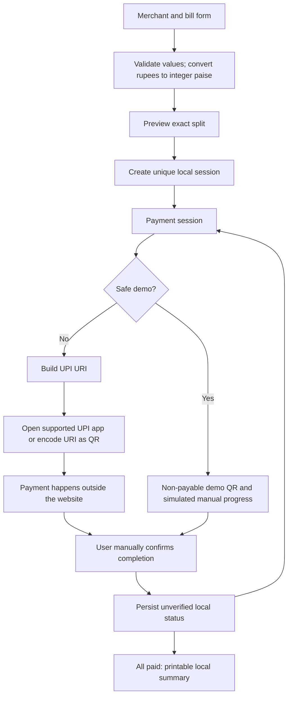

# Architecture

SplitUPI has a Next.js App Router shell and client-side payment-session state. There is no database, authentication, payment-processing backend, or webhook endpoint in this prototype.

## Routes and responsibilities

| Route | Responsibility |
| --- | --- |
| `/` | Product introduction, explanatory split, and safe live-demo entry |
| `/demo` | Shareable entry; **Start live demo** creates a fresh local sample |
| `/create` | Merchant/invoice entry, exact amount validation, and split preview |
| `/session/[id]` | Local session lookup, request cards, QR modal, progress, and manual confirmation |
| `/receipt/[id]` | Local summary, print-to-PDF, and share moment |
| `/about` | Payment-confirmation limitations and future integration explanation |

The dynamic route identifier selects a record from the current browser’s local storage. It is not a server lookup, a secret, or an authorization mechanism. A missing local record must produce a useful empty state.

| Module | Responsibility |
| --- | --- |
| `components/payment-form.tsx`, `split-editor.tsx` | Form state, accessible inputs, split selection, and preview |
| `components/payment-session.tsx`, `qr-modal.tsx` | Request gating, intent launch, QR presentation, and manual confirmation |
| `components/receipt.tsx` | Completion guard, printable record, and demo sharing |
| `components/use-session.ts` | Load local state and react to session updates |
| `lib/formatting.ts`, `splitting.ts`, `validation.ts` | Exact parsing/formatting, amount allocation, and input constraints |
| `lib/upi.ts`, `qr.ts` | Encoded UPI intent and QR creation |
| `lib/storage.ts`, `types.ts` | Validated persistence, state transitions, and domain types |
| `app/layout.tsx`, `opengraph-image.tsx` | Page shell, metadata, and share image |



## Domain invariants

- Money is an integer count of paise. A displayed ₹2,000 corresponds to `200000` internally.
- A bill and every chunk must be positive, valid amounts within application bounds.
- For every accepted split, `sum(chunks) === totalPaise` exactly.
- Threshold splitting uses an explicit configurable amount. The default `200000` paise has no fee or regulatory meaning.
- Equal splitting allocates whole paise and distributes the remainder; it must never lose or invent a fraction of the bill.
- Custom splitting is accepted only when every item is valid and the exact sum matches the bill.
- Each session and chunk has a stable identifier so reloads preserve request identity.
- A session retains merchant name, VPA, optional invoice, total, chunks, statuses, and creation time.
- Local chunk statuses are `pending`, `paid`, and `cancelled`. `paid` means manually marked complete, never bank-verified.
- Paid total includes only locally paid chunks. Remaining is the bill minus that total; cancelled chunks do not count as paid. Completion percentage derives from the paid amount.

Default sequential mode enables the next eligible request only after its predecessor is paid. The parallel-payment option is explicit. A paid/cancelled item must not offer another payment launch through normal UI controls. Manual confirmation should be idempotent: repeating it cannot add the same amount twice.

`splitAmount` accepts and returns rupees at its public boundary for convenient form integration; it immediately converts to integer paise for allocation and validation. Stored sessions use `totalPaise` and each payment's `amountPaise`.

```ts
splitAmount("5500", { type: "threshold" }); // [2000, 2000, 1500]
splitAmount("100", { type: "equal", count: 3 }); // [33.34, 33.33, 33.33]
splitAmount("100", { type: "custom", amounts: ["40", "60"] }); // [40, 60]
```

Equal allocation uses `floor(totalPaise / count)` and adds one paise to the first `totalPaise % count` payments. The prototype caps a bill at ₹1,00,00,000 and a split at 100 requests to bound local UI/storage work. These are application limits, not statements about UPI eligibility or transaction limits.

## UPI boundary

The URI builder receives validated merchant details and a positive amount and serializes encoded parameters. It emits `pa`, `pn`, `am`, and `cu=INR`; optional `tr` and `tn` carry a reference and note. A generated reference helps identify the request but is not provider registration, verification, or an enforceable duplicate-payment lock.

For real sessions, both the button and QR consume the same URI. QR generation uses the `qrcode` library. The browser does not know whether a UPI app accepted the request, whether the user approved it, or whether settlement occurred.

The fictional demo VPA is not a verified destination or verified nonexistent account. Safe demos therefore use a non-payable payload and cannot launch the placeholder as a payment. Real URI generation requires merchant details entered for an actual test.

Local cancellation, closing a modal, or navigating away has no effect on a QR already saved elsewhere or on a bank transfer. No countdown should imply enforceable expiry. A generic UPI URI does not ensure every app will lock the amount, accept the VPA, or support the same optional fields.

## Persistence and trust

The browser storage adapter owns serialization, reading, updating, and error handling. Corrupt or incompatible records should fail safely with a recoverable state. Storage failures must be visible rather than implying a session was safely saved.

`localStorage` is per browser and per origin, readable by scripts running in that origin, and editable by its owner. It offers neither a shared ledger nor trustworthy audit evidence. A receipt is an unverified local summary, and sharing a session route does not share the stored record. **Copy demo link** copies the current origin plus `/demo`; the visitor presses **Start live demo** to create a fresh safe demonstration.

## Future authoritative verification

This is a design direction, not an implemented or simulated integration:

1. Establish a legitimate provider relationship and merchant onboarding flow. Confirm the provider’s supported payment-request and reconciliation interfaces.
2. Create the bill, chunks, merchant binding, and provider-issued request references on a server. Persist them in an independent ledger before handing payment instructions to a client.
3. Track provider-backed payment attempts with explicit `created`, `pending`, `verified`, `failed`, and `cancelled` states. Retain every attempt and event; do not overwrite evidence with a browser assertion.
4. Receive server-to-server provider notifications, verify signatures against the unmodified request body, and apply any required timestamp/replay checks. Store provider event IDs and process retries idempotently inside database transactions.
5. Confirm provider status, amount, currency, merchant/payee, and reference against the original request. Only a valid authoritative match may produce `verified` status. A manual mark or app return is not sufficient.
6. Reconcile independently against the provider’s authoritative records to catch missing, delayed, duplicate, or out-of-order events. Represent refunds, reversals, disputes, and settlement separately as the provider model requires.
7. Expose authenticated read APIs to the UI. Keep secrets on the server, preserve an audit trail, and use provider-supported cancellation and idempotency features where available.

Do not assume a terminal state can never change: a delayed successful payment can arrive after a local cancellation. Preserve that event and reconcile it according to the provider contract. Fee assessment and transaction classification remain governed by applicable rules and the provider’s actual implementation.
